The final project counts for **30%** of the grade, with **the same rubric for both tracks**.
It assesses the technical mastery of the module's skills on a concrete problem, mixing
several techniques seen in class (asyncio, multiprocessing, Dask, GPU depending on the
topic).

## Framework

- **Alone or in a pair** (communication arrangements chosen by the pair).
- **Duration**: from the launch (end of October) to the **defense on 19/11**; the **report**
  is handed in before the defense.
- **Common constraints**: the project must *actually* use parallelism (not disguised
  sequential code), the gains must be **measured and justified**, and the code must be
  **reproducible** (readable README, demonstration script).

## Proposed topics

> **Work in progress** — the list of projects is not finalized. The **sixteen topics below
> are *candidates***: the first seven were not run last year, and the nine new ones are
> either new directions or higher-expectation extensions of topics already done last year.
> Taking any one means being the first team on it. More topics may be added before the
> launch. The framework, deadlines, defense and grading rubric above already hold, and you
> can still propose your own topic as long as it uses the module's techniques.

### Code assistants

#### Deep research assistant for creating a README for a codebase (agentic/MCP version)

{width="200px"}

Build an **agentic** assistant (tools + retrieval, not a fixed pipeline) that analyzes a
codebase, infers the project structure, and generates a high-quality README with a summary,
usage and architecture details. Unlike the classic pipeline version (done last year), the
challenge here is the agent loop: which tools the assistant calls, in which order, and how
it validates its own output.

**Deliverables**: a set of LLM configurations with MCP servers and prompts (Zed, Continue,
or any harness you prefer) that generate a `README.md` for a given codebase, plus a short
comparison with the non-agentic pipeline approach.

Background: [Open Deep Research](https://huggingface.co/blog/open-deep-research) ("deep
research" = an LLM driven by an agentic framework that organizes its actions in steps; here
the "search" is codebase extraction instead of web search) and
[Building Deep Research from scratch](https://www.newsletter.swirlai.com/p/building-deep-research-agent-from).

#### Agentic code review agent

{width="200px"}

Build an **agentic** assistant that reviews code changes (a diff / pull request) and
produces structured findings (bug, style, missing tests) with severity and justification.
The challenge is the agent loop and the parallelization: reviewing several files in
parallel (asyncio / threads or parallel sub-agents), then a "judge" agent that deduplicates
and filters low-confidence findings before publication.

**Deliverables**: a CLI or MCP server that fetches a PR, analyzes the diff per file, and
emits findings; optionally a benchmark (precision/recall/F1) on a set of labeled PRs, and a
short comparison with a human review.

Background: [GitHub Copilot code review](https://docs.github.com/en/copilot/how-tos/review-code/),
[Qodo / PR-Agent](https://github.com/qodo-ai/pr-agent) (open-source, Apache 2.0),
[CodeRabbit](https://www.coderabbit.ai/), [GitHub PR files API](https://docs.github.com/en/rest/pulls/pulls#list-pull-request-files),
[PyGithub](https://github.com/PyGithub/PyGithub).

**Starter / concrete example**: pick a real PR — e.g. a recent pull request from `dask/dask`
or one in the module's own repos. Fetch it with the GitHub REST API
(`GET /repos/{owner}/{repo}/pulls/{n}/files`), split the diff per file, and review each file
in parallel with `asyncio.gather` + a `Semaphore(3)`. Have each reviewer return a typed JSON
finding (`{"severity": "high|medium|low", "category": "bug|style|test|perf", "justification": "..."}`),
then a judge agent that merges, deduplicates and drops findings below a confidence threshold.
For the benchmark, label 10–20 PRs (known bugs, missing tests) and report precision/recall/F1
vs a human review.

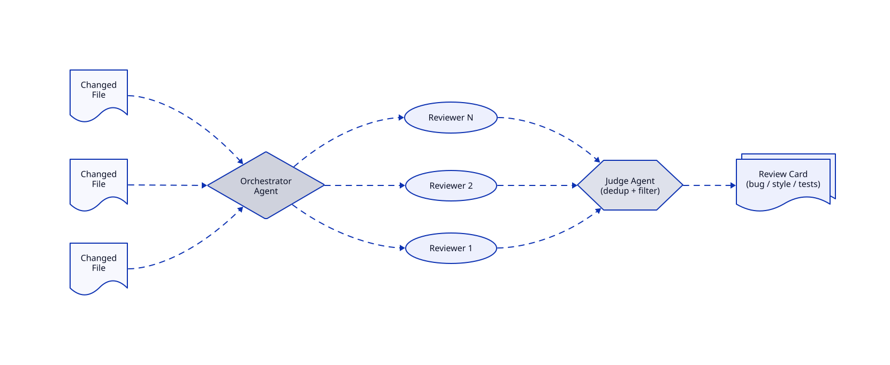

### LLM agents & evaluation

#### RAG with an evaluation framework

{width="200px"}

Build a **hybrid RAG pipeline** (BM25 + dense embeddings, RRF fusion, reranker) on a corpus,
and — the real challenge — an **evaluation** module that measures retrieval and answer
quality (faithfulness, context relevance, precision, recall, MRR/NDCG). Compare several
chunking × retrieval configurations and produce a comparative report.

**Deliverables**: the RAG pipeline, the evaluation harness (RAGAS/TruLens or an in-house
metric suite), a comparative report, and a dashboard (Streamlit).

References: [RAGAS](https://github.com/explodinggradients/ragas),
[TruLens](https://github.com/truera/trulens),
[hybrid retrieval](https://weaviate.io/blog/documents/hybrid-search),
[Qwen3-Embedding-0.6B](https://huggingface.co/Qwen/Qwen3-Embedding-0.6B),
[Qwen3-Reranker-0.6B](https://huggingface.co/Qwen/Qwen3-Reranker-0.6B),
[Reciprocal Rank Fusion](https://en.wikipedia.org/wiki/Reciprocal_rank_fusion),
[MS MARCO](https://microsoft.github.io/msmarco/).

**Starter / concrete example**: index a concrete corpus — e.g. the module's own Quarto book
(`Cours-programmation-MIASHS-2026`) or a set of the course PDFs — as Markdown chunks. Build
hybrid retrieval: BM25 (sparse) + dense embeddings (`Qwen3-Embedding-0.6B`), fuse with RRF,
then rerank the top-20 with `Qwen3-Reranker-0.6B`. For evaluation, use RAGAS metrics
(faithfulness, answer relevancy, context precision/recall) plus retrieval metrics (MRR@10,
nDCG@10) on ~50 hand-written questions with gold passages. Run a grid over chunk sizes
(256/512/1024) × top-k and output a comparative table.

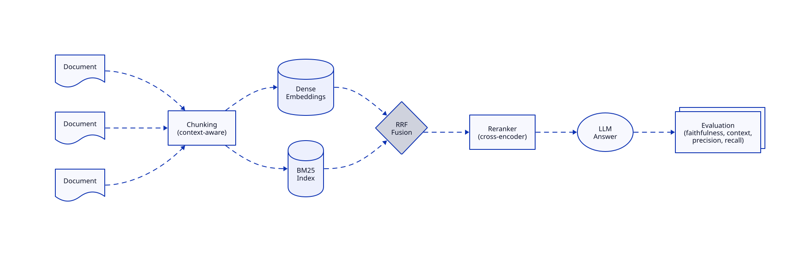

#### Socratic tutor agent

{width="200px"}

Build a **socratic tutoring agent**: a prompt system + question templates (by Bloom level)
that guides a student through a programming exercise with questions instead of answers.
Evaluate it against a simulated student (or a small corpus): number of steps before
resolution, hints given, conceptual progression, and a LLM-as-judge pedagogical score.
Compare 2–3 models/prompts and produce a session report with an automatic log.

**Deliverables**: the tutor agent, an evaluation harness, a session log, and a comparative
report.

References: [SocraticLM](https://github.com/Ljyustc/SocraticLM) (NeurIPS 2024; SocraTeach dataset),
[MathTutorBench](https://github.com/eth-lre/mathtutorbench) (EMNLP 2025; 7 tutor tasks incl. socratic questioning),
[MathTutorBench site](https://eth-lre.github.io/mathtutorbench/),
[Qwen2.5-Math SocraticLM](https://huggingface.co/CogBase/SocraticLM).

**Starter / concrete example**: drive the tutor on a real exercise — e.g. "write a recursive
function to compute Fibonacci" or "fix this bug in a loop". Use a prompt system + question
templates by Bloom level (remember, understand, apply, analyse, evaluate) and log every turn
(student answer, hint, escalation). For evaluation, reuse the MathTutorBench tasks (e.g.
`socratic_questioning.yaml`) or the SocraTeach dialogues (`github.com/Ljyustc/SocraticLM`), and
score with an LLM-as-judge rubric (hint timing, scaffolding, conceptual progression). Compare
2–3 models/prompts and report steps-to-resolution + hints given.

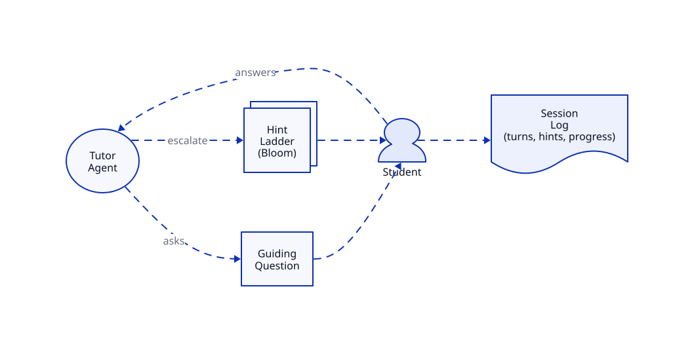

### Local models & multimodal inference

#### Local decision-model pipeline (Jev / d3)

{width="200px"}

Build a fully local pipeline that uses a **decision model** (Jev / d3, or a
cross-encoder reranker + zero-shot classifier) instead of an autoregressive LLM:
the model outputs probabilities / typed decisions without decoding text, so
responses are fast and cheap. Use it to rerank retrieval candidates and to
zero-shot classify / route queries or documents, then measure latency and
throughput against an LLM baseline.

**Deliverables**: the pipeline, a latency/throughput benchmark, a short quality
comparison (nDCG@10, accuracy), and a write-up.

References: [Jev / JEV-9B](https://huggingface.co/autotrust/JEV-9B),
[jev-reranker (Jev as a reranker)](https://huggingface.co/blog/hotchpotch/introducing-jev-reranker),
[d3 decision model](https://huggingface.co/vllm-sr/d3),
[Decision 3.0 collection](https://huggingface.co/collections/vllm-sr/decision-30),
[Jev Decision Index](https://huggingface.co/spaces/multimodalart/jev-decision-index),
[Qwen3-Reranker-0.6B](https://huggingface.co/Qwen/Qwen3-Reranker-0.6B),
[bge-reranker-v2-m3](https://huggingface.co/BAAI/bge-reranker-v2-m3),
[zero-shot classification (bart-large-mnli)](https://huggingface.co/facebook/bart-large-mnli),
[BTZSC benchmark](https://arxiv.org/html/2603.11991).

**Starter / concrete example**: build a concrete router/reranker. Take a query, retrieve
top-100 candidates via hybrid search, then use Jev (`autotrust/JEV-9B`) or d3 (`vllm-sr/d3`)
to score each candidate: ask "is this candidate relevant to the query?" and get back a
calibrated probability (no text decoding). Also zero-shot classify the query into a label set
(e.g. `factual | math | code | summary | other`) using `facebook/bart-large-mnli` or d3. Measure
latency (ms/decision) and throughput (decisions/s) vs the LLM baseline (`Qwen3-Reranker-0.6B`
cross-encoder), and compare nDCG@10 / accuracy. See the `jev-reranker` blog for the pattern.

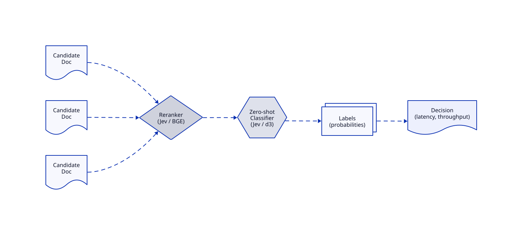

#### Multimodal embedding pipeline (EmbeddingGemma 2)

{width="200px"}

Build a local **multimodal index** with `google/embeddinggemma-2`: text, code,
images, video and audio all project into one 768-dimensional space. Index a
mixed corpus (PDFs + images + audio + code), search across modalities, and
measure latency/memory across truncation (768→512/256/128) and quantization
(BF16 vs GGUF). Optionally add a reranker as a second stage.

**Deliverables**: the encoder + index, a cross-modal retrieval demo, a
latency/memory report, and a quality comparison (Recall@k/MRR by modality).

References: [EmbeddingGemma 2](https://huggingface.co/google/embeddinggemma-2),
[EmbeddingGemma 2 developer guide](https://developers.googleblog.com/embeddinggemma-2-the-developer-guide/),
[EmbeddingGemma 2 GGUF (unsloth)](https://huggingface.co/unsloth/embeddinggemma-2-GGUF),
[EmbeddingGemma2 in transformers](https://huggingface.co/docs/transformers/en/model_doc/embedding_gemma2),
[Matryoshka truncation](https://en.wikipedia.org/wiki/Matryoshka_representation_learning),
[Qdrant](https://qdrant.tech/), [sentence-transformers](https://sbert.net/).

**Starter / concrete example**: index a mixed local corpus: PDFs of the course, figures
(PNG/SVG), audio recordings, and `.qmd`/`.py` code. Use `google/embeddinggemma-2` (740M full
multimodal; you can also load only the 270M text encoder for a cheap baseline). All modalities
project into one 768-dim space, so a text query can retrieve an image or an audio segment.
Demonstrate cross-modal search: "find the figure about SIMD", "find the audio segment about
backpressure". Then measure Recall@k / MRR per modality, and memory/latency across MRL
truncation (768→512→256→128) and quantization (BF16 vs the `unsloth/embeddinggemma-2-GGUF`
GGUF). See the developer guide for the modular-encoder trick.

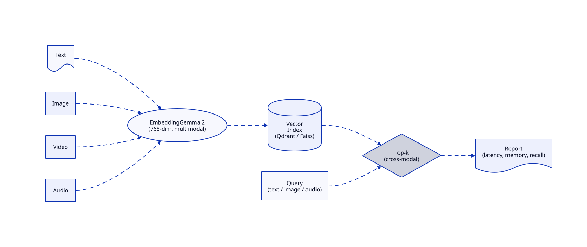

#### Multi-agent LLM orchestration (parallel endpoints)

{width="200px"}

Build an **orchestrator** that fans out a query to several **parallel agents** (each on one
of the 7 Gemma-4-26B-A4B endpoints provided), then a **judge** agent that fuses, deduplicates
and filters the results. Measure the speedup (1 vs 2 vs 4 vs 7 agents), latency, throughput,
and the quality of the ensemble vs a single agent.

**Deliverables**: the orchestrator (asyncio/HTTP, retries, backpressure), the judge, a
speedup/quality benchmark, and a write-up.

References: [LangGraph](https://github.com/langchain-ai/langgraph),
[CrewAI](https://github.com/crewAIInc/crewAI), [AutoGen](https://github.com/microsoft/autogen),
[vLLM data-parallel](https://docs.vllm.ai/), [asyncio Semaphore](https://docs.python.org/3/library/asyncio-sync.html),
[Tenacity retries](https://github.com/jd/tenacity).

**Starter / concrete example**: fan out a concrete query (e.g. "explain the trade-offs of
optimistic locking, with a Python example") to the 7 Gemma-4-26B-A4B endpoints, each with a
distinct role prompt (correctness, performance, security, style, completeness, concurrency,
simplicity). Run them in parallel with `asyncio` + a `Semaphore` (per-request timeout +
exponential backoff), then a judge agent that fuses and deduplicates. Measure wall-clock
speedup (1 vs 2 vs 4 vs 7 agents), latency, throughput, and ensemble quality (LLM-as-judge
vs a single agent). See vLLM data-parallel and LangGraph/CrewAI/AutoGen for the orchestration
patterns.

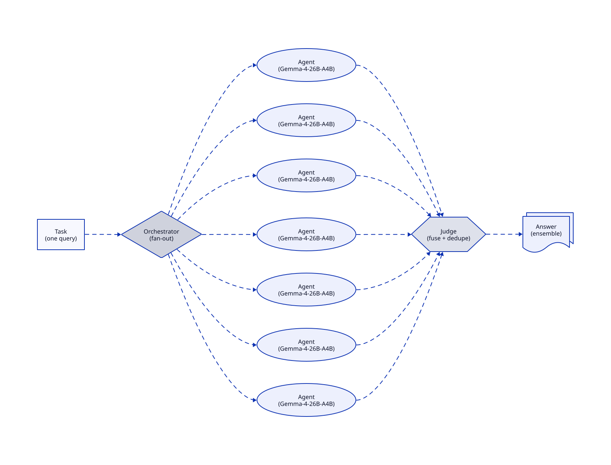

### Parallel systems

#### Locking Strategy Lab: coarse vs fine vs optimistic vs RW locks

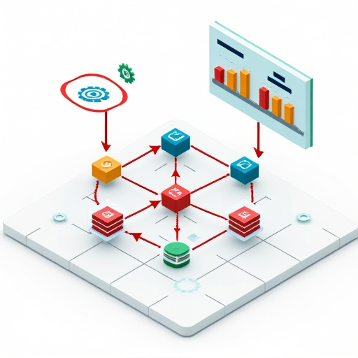{width="200px"}

Implement and compare several locking strategies on a shared structure (e.g., a graph or a
ledger):

- **Coarse grain**: one global lock protecting the whole structure;
- **Fine grain**: sharded locks or per-node locks;
- **Reader–Writer lock**: shared readers, exclusive writers;
- **Optimistic reads** (versioning / retry): read without lock, validate a version or CAS;
- optional: lock-free / CAS implementations in a lower-level language.

**Deliverables**: the implementations, a micro-benchmark harness, plots comparing
throughput vs contention, and a write-up with recommendations.

References: [locks and trade-offs](https://en.wikipedia.org/wiki/Lock_(computer_science)),
[readers–writer locks](https://en.wikipedia.org/wiki/Readers%E2%80%93writer_lock),
[optimistic concurrency control](https://en.wikipedia.org/wiki/Optimistic_concurrency_control),
[Python threading locks](https://docs.python.org/3/library/threading.html#lock-objects),
[Python atomics](https://github.com/doodspav/atomics).

#### Multi-stage image pipeline with backpressure and flow control

{width="200px"}

Implement a 3+ stage image processing pipeline with **bounded queues, backpressure
propagation, and dynamic scaling heuristics** — what happens when one stage is slower than
the others, and how the pipeline degrades.

**Deliverables**: pipeline code, scaling heuristics, benchmark, a short UI or logging
dashboard.

Typical pipelines: a generic supervised computer-vision pipeline (classification or
recognition), or an OCR pipeline (detection + recognition).

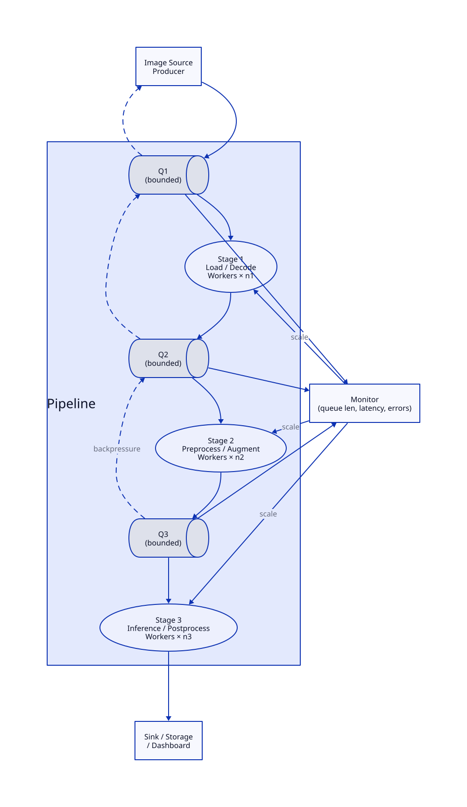

#### SIMD / vectorized kernel lab

{width="200px"}

Write and benchmark the same numerical kernel (sum, dot product, stencil, haversine,
Mandelbrot) in several implementations: numpy vectorized, numexpr, numba `@njit`/`@vectorize`,
Cython, and C + SIMD intrinsics. Compare explicit SIMD vs auto-vectorization, measure
throughput/bandwidth, and produce an automated benchmark report with profiling.

**Deliverables**: the kernels, a reproducible benchmark harness (perf_counter /
pytest-benchmark), plots, and a write-up with recommendations.

References: [Numba vectorize](https://numba.readthedocs.io/en/stable/user/vectorize.html),
[Numba SIMD examples](https://github.com/numba/numba-examples/blob/master/notebooks/simd.ipynb),
[SIMD autovectorization in Numba](https://tbetcke.github.io/hpc_lecture_notes/simd.html),
[Numexpr](https://github.com/pydata/numexpr), [Cython](https://cython.org/),
[Speeding up Cython with SIMD](https://pythonspeed.com/articles/faster-cython-simd/),
[Intel intrinsics guide](https://www.intel.com/content/www/us/en/docs/intrinsics-guide/index.html).

**Starter / concrete example**: implement the same kernels (dot product, 2D stencil, haversine,
Mandelbrot) in: numpy (vectorized), numexpr, numba `@njit` + `@vectorize`, Cython, and C + AVX
intrinsics. For each, measure throughput/bandwidth with `perf_counter`/`pytest-benchmark` and
inspect the generated SIMD instructions (e.g. `objdump -d`, or Numba's `find_instr`). Compare
explicit SIMD vs auto-vectorization: write the C kernel with `#pragma omp simd` or `-march=native`,
then a version with `_mm256_add_ps` intrinsics. Report speedups vs the numpy baseline and note
when auto-vectorization fails (branches inside the loop).

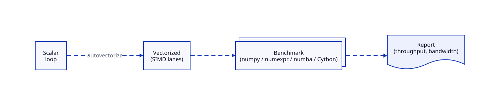

#### IPC / shared-memory pipeline

{width="200px"}

Build a 3+ stage producer–consumer pipeline that passes data between processes using shared
memory (`multiprocessing.shared_memory`), bounded queues, and optional Unix sockets / ZeroMQ.
Measure throughput and latency, compare the mechanisms (Queue vs Pipe vs shared_memory vs
ZeroMQ/Redis), and add backpressure / flow control and a multi-consumer variant.

**Deliverables**: the pipeline, a benchmark comparing the IPC mechanisms, plots, and a
write-up (with a note on the shared-memory pitfalls).

References: [multiprocessing.shared_memory](https://docs.python.org/3/library/multiprocessing.html#multiprocessing.shared_memory.SharedMemory),
[ZeroMQ](https://zeromq.org/), [py-sharedmemory](https://github.com/salvatore-giordano/py-sharedmemory),
[Unix domain sockets](https://docs.python.org/3/library/socket.html#socket.socketpair).

**Starter / concrete example**: build a 3-stage pipeline (producer → transform → consumer) that
moves numpy arrays / image frames between processes. Implement it four ways:
`multiprocessing.Queue`, `Pipe`, `multiprocessing.shared_memory` (with a bounded ring buffer +
`Semaphore`/`Lock`), and ZeroMQ (or Redis). Fix a payload size (e.g. 1 MB frames) and measure
throughput (frames/s) and latency for each mechanism. Add a slow-consumer scenario to show
backpressure, and a multi-consumer fan-out (1 producer → N consumers). Report the shared-memory
pitfalls (stale data, synchronization, cleanup).

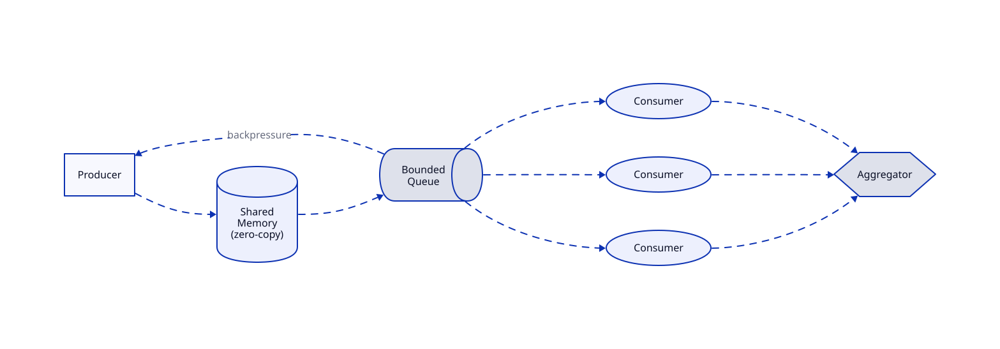

### Distributed: Dask and Ray

#### Synthetic Dask DAG generator for evaluating task fusion and scheduling strategies

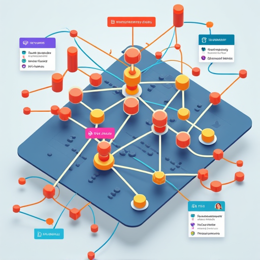{width="200px"}

Create a synthetic DAG generator that varies task sizes, dependencies, and fusion
parameters, and use it to evaluate how the Dask scheduler behaves.

**Deliverables**: the generator, a benchmark harness, plots, and scheduler tuning
recommendations.

A small starter script is provided: [synthetic_dask_dag.py](downloads/synthetic_dask_dag.py)
(builds a random acyclic task graph with `dask.delayed`, visualizes it with graphviz, and
optionally runs it under different schedulers — it is a starting point, not the project).

References: [official Dask benchmarks](https://github.com/dask/dask-benchmarks),
[Dask graphs](https://docs.dask.org/en/latest/graphs.html),
[Dask optimizations](https://docs.dask.org/en/stable/optimize.html).

#### Ray distributed training of small LLMs

{width="200px"}

Use Ray (Ray Train + Ray Data LLM / vLLM) to **fine-tune a small model** (QLoRA: 4-bit base
+ LoRA adapters) on a task, then parallelize batch inference across several GPU workers and
compare with the sequential baseline (speedup, GPU utilization, quality). Optionally compare
quantizations (FP16 vs GGUF Q4 vs NF4).

**Deliverables**: the training/inference scripts, a speedup report, a short quality
comparison, and the reproducibility setup.

References: [Ray: working with LLMs](https://docs.ray.io/en/latest/llm/),
[Ray Train](https://docs.ray.io/en/latest/train/train.html),
[Unsloth](https://github.com/unslothai/unsloth), [vLLM](https://docs.vllm.ai/),
[QLoRA](https://arxiv.org/abs/2305.14314).

**Starter / concrete example**: fine-tune a small model (e.g. `Qwen3-0.6B` or `SmolLM2-360M`)
with QLoRA (4-bit base + LoRA adapters) on a concrete task — e.g. a small code-instruction
dataset or a math word-problem dataset. Use Ray Train + Ray Data for data loading and training,
then parallelize batch inference with vLLM across 2–4 GPU workers. Measure wall-clock speedup
vs the sequential baseline, GPU utilization (Ray dashboard), and quality (BLEU/accuracy on a
small eval set). Optionally compare quantizations (FP16 vs GGUF Q4 vs NF4).

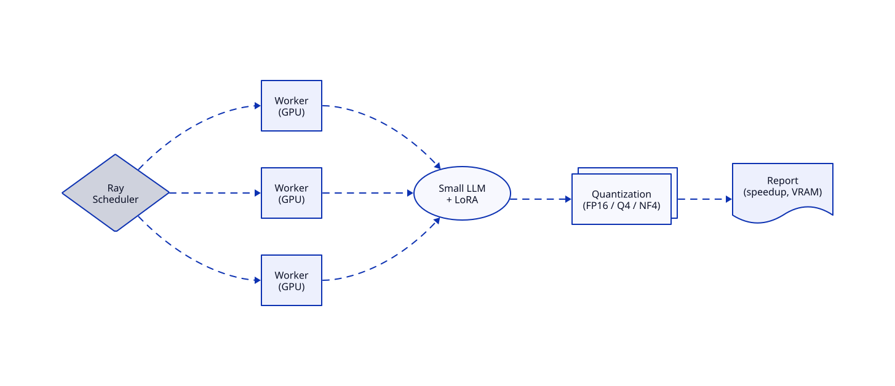

### WebGPU

#### Proof of concept: WebGPU for OLAP queries in the browser

{width="200px"}

Demonstrate how WebGPU can accelerate in-browser **OLAP** operations (filters, group-bys,
aggregates) on columnar data. What is OLAP? See
[Online Analytical Processing](https://en.wikipedia.org/wiki/Online_analytical_processing)
— fast, consistent, interactive access to data for analysis.

**Deliverables**: an in-browser demo and a short performance report.

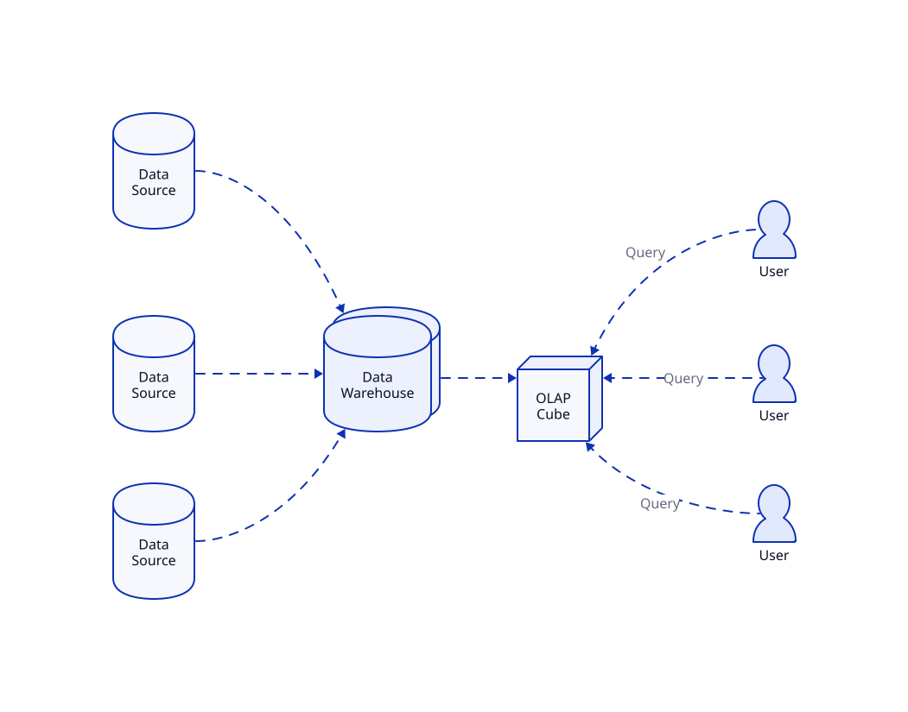

#### WebGPU path tracing

{width="200px"}

Starting point: the existing repo
[ferminLR/webgpu-path-tracing](https://github.com/ferminLR/webgpu-path-tracing). Implement
one or more of the TODO items it lists: advanced shader/task mapping, performance tuning,
etc.

**Deliverables**: a pull request to the repo with one or more completed TODO items.

#### ETL + WebGPU visualization dashboard with Dask and Streamlit

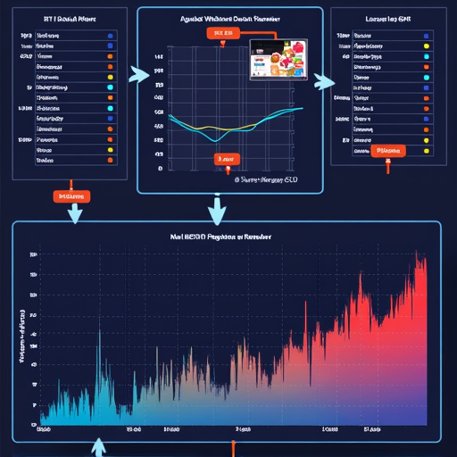{width="200px"}

Run the ETL at scale locally with Dask, and visualize large aggregated results in the
browser using WebGPU for rendering (or via a Streamlit embedding).

**Deliverables**: the Dask ETL pipeline, a WebGPU visualizer front-end, a fallback
renderer, and a performance report.

## Minimal specification

1. **Clean Git repository**: readable history, no large data in the repository.
2. **README**: objective, installation (pinned dependencies), launch command, sample output.
3. **Runnable code**: main script + *minimal* tests (at least one unit test on a key
   function).
4. **Measurements**: at least one comparative table (sequential vs parallel, or worker
   variants) and the interpretation in 3–5 lines.
5. **Report (4–6 pages)**: objectives, architecture (diagram), technical choices,
   measurements, limits, what was learned.

## Grading rubric (overall weight: 30%)

| Criterion | Detail | Internal weight |
|---|---|---|
| Technical mastery | Parallelism *actually* used and justified; no fake parallelism (GIL, blocked event loop, deadlock); resource management | 30% |
| Code quality | Readability, structure, error handling, basic tests, reproducible measurements | 25% |
| Compliance with the target | Answers to the objectives set in the learning plan; respect of the specification | 20% |
| Communication | Defense (5–8 min + questions), live demo, ability to explain choices and limits | 25% |

The 30% share of the final grade is given by the instructor on this rubric, identically for
tracks A and B.

## Defense (S11, 19/11, 13:30–15:30)

- **5–8 minute presentation** + questions: what the project does, how it is parallelized,
  what gains were measured, what limits remain.
- The **report** is submitted before the session. Alternative arrangements (individual
  session, video submission) are planned if needed.

## Frequently asked questions

- **Can I use one more library?** Yes, as long as the module's technical subject (asyncio,
  IPC, Dask, vectorization, GPU/WebGPU depending on the topic) stays the justified core.
- **What if my hardware has no GPU?** GPU topics are optional; an asyncio/Dask/numpy
  vectorization project is more than enough. The kick-off survey is precisely used to
  calibrate these choices.
- **Does the pair count?** The level of expectation is adjusted (a more ambitious collective
  deliverable, or two clearly separated contributions); the roles are spelled out in the
  report.
