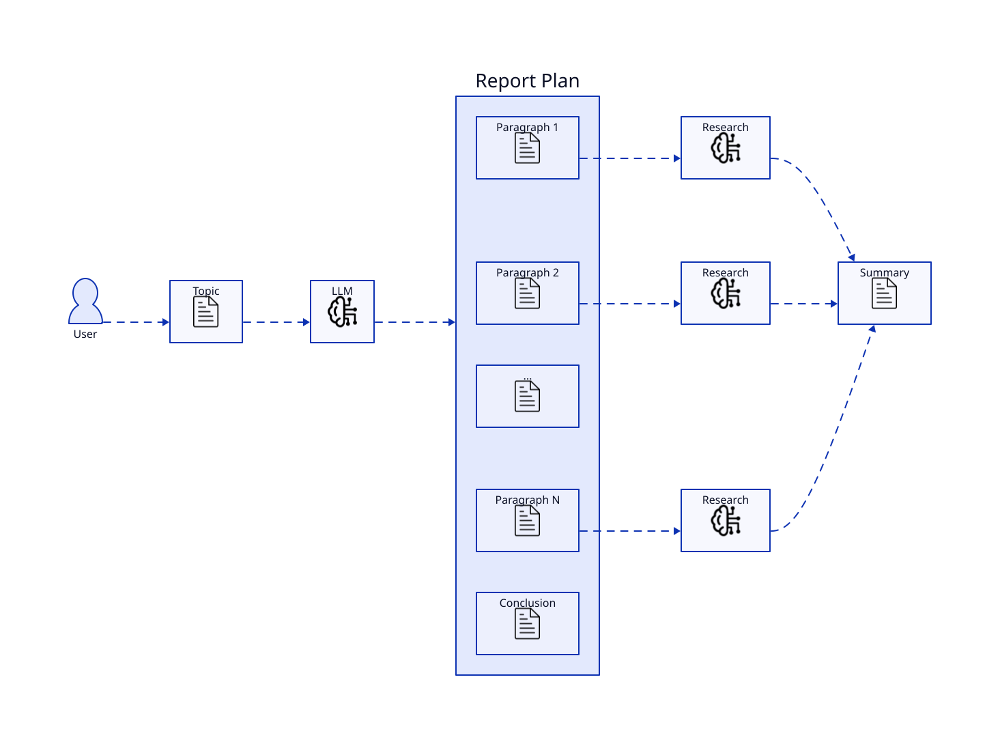
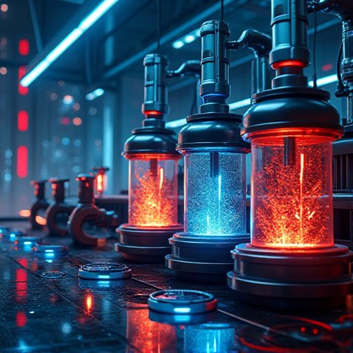
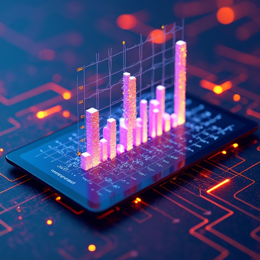
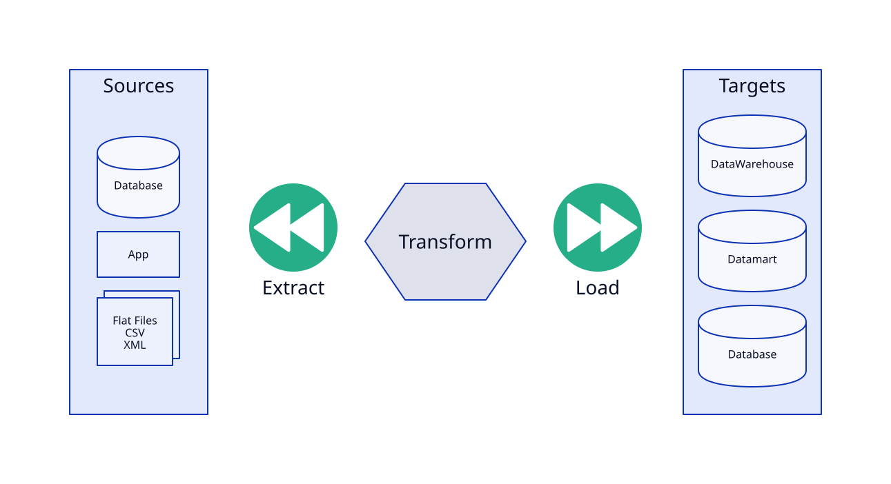

The final project counts for **30%** of the grade, with **the same rubric for both tracks**.
It assesses the technical mastery of the module's skills on a concrete problem, mixing
several techniques seen in class (asyncio, multiprocessing, Dask, GPU depending on the
topic).

## Framework

- **Alone or in a pair** (communication arrangements chosen by the pair).
- **Duration**: from the launch (end of October) to the **defense on 18/11**; the **report**
  is handed in before the defense.
- **Common constraints**: the project must *actually* use parallelism (not disguised
  sequential code), the gains must be **measured and justified**, and the code must be
  **reproducible** (readable README, demonstration script).

## Proposed topics

> **Work in progress** — the list of projects is not finalized. The seven topics below are
> *candidates*: none of them was run last year, so taking one means being the first team on
> it. More topics will be added before the launch. The framework, deadlines, defense and
> grading rubric above already hold, and you can still propose your own topic as long as it
> uses the module's techniques.

### Code assistants

#### Deep research assistant for creating a README for a codebase (agentic/MCP version)

{width="200px"}

Build an **agentic** assistant (tools + retrieval, not a fixed pipeline) that analyzes a
codebase, infers the project structure, and generates a high-quality README with a summary,
usage and architecture details. Unlike the classic pipeline version (done last year), the
challenge here is the agent loop: which tools the assistant calls, in which order, and how
it validates its own output.

**Deliverables**: a set of LLM configurations with MCP servers and prompts (Zed, Continue,
or any harness you prefer) that generate a `README.md` for a given codebase, plus a short
comparison with the non-agentic pipeline approach.

Background: [Open Deep Research](https://huggingface.co/blog/open-deep-research) ("deep
research" = an LLM driven by an agentic framework that organizes its actions in steps; here
the "search" is codebase extraction instead of web search) and
[Building Deep Research from scratch](https://www.newsletter.swirlai.com/p/building-deep-research-agent-from).

### Parallel systems

#### Locking Strategy Lab: coarse vs fine vs optimistic vs RW locks

{width="200px"}

Implement and compare several locking strategies on a shared structure (e.g., a graph or a
ledger):

- **Coarse grain**: one global lock protecting the whole structure;
- **Fine grain**: sharded locks or per-node locks;
- **Reader–Writer lock**: shared readers, exclusive writers;
- **Optimistic reads** (versioning / retry): read without lock, validate a version or CAS;
- optional: lock-free / CAS implementations in a lower-level language.

**Deliverables**: the implementations, a micro-benchmark harness, plots comparing
throughput vs contention, and a write-up with recommendations.

References: [locks and trade-offs](https://en.wikipedia.org/wiki/Lock_(computer_science)),
[readers–writer locks](https://en.wikipedia.org/wiki/Readers%E2%80%93writer_lock),
[optimistic concurrency control](https://en.wikipedia.org/wiki/Optimistic_concurrency_control),
[Python threading locks](https://docs.python.org/3/library/threading.html#lock-objects),
[Python atomics](https://github.com/doodspav/atomics).

#### Multi-stage image pipeline with backpressure and flow control

{width="200px"}

Implement a 3+ stage image processing pipeline with **bounded queues, backpressure
propagation, and dynamic scaling heuristics** — what happens when one stage is slower than
the others, and how the pipeline degrades.

**Deliverables**: pipeline code, scaling heuristics, benchmark, a short UI or logging
dashboard.

Typical pipelines: a generic supervised computer-vision pipeline (classification or
recognition), or an OCR pipeline (detection + recognition).

### Distributed: Dask and Ray

#### Synthetic Dask DAG generator for evaluating task fusion and scheduling strategies

{width="200px"}

Create a synthetic DAG generator that varies task sizes, dependencies, and fusion
parameters, and use it to evaluate how the Dask scheduler behaves.

**Deliverables**: the generator, a benchmark harness, plots, and scheduler tuning
recommendations.

A small starter script is provided: [synthetic_dask_dag.py](downloads/synthetic_dask_dag.py)
(builds a random acyclic task graph with `dask.delayed`, visualizes it with graphviz, and
optionally runs it under different schedulers — it is a starting point, not the project).

References: [official Dask benchmarks](https://github.com/dask/dask-benchmarks),
[Dask graphs](https://docs.dask.org/en/latest/graphs.html),
[Dask optimizations](https://docs.dask.org/en/stable/optimize.html).

### WebGPU

#### Proof of concept: WebGPU for OLAP queries in the browser

{width="200px"}

Demonstrate how WebGPU can accelerate in-browser **OLAP** operations (filters, group-bys,
aggregates) on columnar data. What is OLAP? See
[Online Analytical Processing](https://en.wikipedia.org/wiki/Online_analytical_processing)
— fast, consistent, interactive access to data for analysis.

**Deliverables**: an in-browser demo and a short performance report.

#### WebGPU path tracing

{width="200px"}

Starting point: the existing repo
[ferminLR/webgpu-path-tracing](https://github.com/ferminLR/webgpu-path-tracing). Implement
one or more of the TODO items it lists: advanced shader/task mapping, performance tuning,
etc.

**Deliverables**: a pull request to the repo with one or more completed TODO items.

#### ETL + WebGPU visualization dashboard with Dask and Streamlit

{width="200px"}

Run the ETL at scale locally with Dask, and visualize large aggregated results in the
browser using WebGPU for rendering (or via a Streamlit embedding).

**Deliverables**: the Dask ETL pipeline, a WebGPU visualizer front-end, a fallback
renderer, and a performance report.

## Minimal specification

1. **Clean Git repository**: readable history, no large data in the repository.
2. **README**: objective, installation (pinned dependencies), launch command, sample output.
3. **Runnable code**: main script + *minimal* tests (at least one unit test on a key
   function).
4. **Measurements**: at least one comparative table (sequential vs parallel, or worker
   variants) and the interpretation in 3–5 lines.
5. **Report (4–6 pages)**: objectives, architecture (diagram), technical choices,
   measurements, limits, what was learned.

## Grading rubric (overall weight: 30%)

| Criterion | Detail | Internal weight |
|---|---|---|
| Technical mastery | Parallelism *actually* used and justified; no fake parallelism (GIL, blocked event loop, deadlock); resource management | 30% |
| Code quality | Readability, structure, error handling, basic tests, reproducible measurements | 25% |
| Compliance with the target | Answers to the objectives set in the learning plan; respect of the specification | 20% |
| Communication | Defense (5–8 min + questions), live demo, ability to explain choices and limits | 25% |

The 30% share of the final grade is given by the instructor on this rubric, identically for
tracks A and B.

## Defense (S11, 18/11, 13:30–15:30)

- **5–8 minute presentation** + questions: what the project does, how it is parallelized,
  what gains were measured, what limits remain.
- The **report** is submitted before the session. Alternative arrangements (individual
  session, video submission) are planned if needed.

## Frequently asked questions

- **Can I use one more library?** Yes, as long as the module's technical subject (asyncio,
  IPC, Dask, vectorization, GPU/WebGPU depending on the topic) stays the justified core.
- **What if my hardware has no GPU?** GPU topics are optional; an asyncio/Dask/numpy
  vectorization project is more than enough. The kick-off survey is precisely used to
  calibrate these choices.
- **Does the pair count?** The level of expectation is adjusted (a more ambitious collective
  deliverable, or two clearly separated contributions); the roles are spelled out in the
  report.
